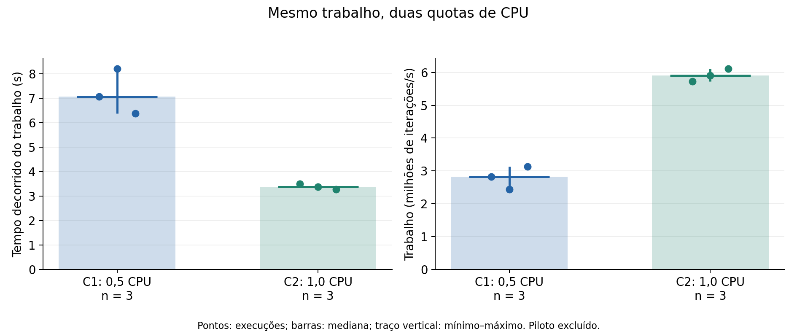

# Atividade 3 - Virtualização, namespaces e cgroups

Laboratório próprio de Sistemas Operacionais (2026.2), sem o kit de apoio do docente. Reutiliza a organização e a experiência da Atividade 2. A carga principal é um cálculo determinístico de CPU, sem RAG, LLM ou GPU.

Entrega prevista: **10/11/2026**. Apresentação: **11/11/2026**, 10-12 minutos e 3-5 minutos de perguntas.

## Situação e artefatos

- **Executado e auditado:** dois contêineres, três namespaces distintos, leitura e escrita negada em mount read-only, piloto e seis execuções válidas.
- **Resultados:** 20.000.000 de iterações por execução, checksum 2589261568. Mediana de wall: 7,0739 s em 0,5 CPU e 3,3840 s em 1 CPU. Razão observada: 2,090 vezes.
- **Pendente da equipe:** revisão, contribuições efetivas, gravação e URL do vídeo, ensaio, commit final e submissão. A atividade ainda não está entregue.

| Artefato | Caminho |
|---|---|
| Relatório PDF para revisão | [output/pdf/relatorio_atividade3.pdf](output/pdf/relatorio_atividade3.pdf) |
| Fonte LaTeX do relatório | [deliverables/relatorio.tex](deliverables/relatorio.tex) |
| Apresentação em PDF | [output/slides/apresentacao_atividade3.pdf](output/slides/apresentacao_atividade3.pdf) |
| Fonte LaTeX Beamer dos slides | [deliverables/apresentacao.tex](deliverables/apresentacao.tex) |
| Roteiro de apresentação e vídeo | [docs/apresentacao.md](docs/apresentacao.md) |
| Falas completas da apresentação, por aluno e slide | [output/pdf/roteiro_apresentacao.pdf](output/pdf/roteiro_apresentacao.pdf) |
| Falas completas do vídeo, por aluno e slide | [output/pdf/roteiro_video.pdf](output/pdf/roteiro_video.pdf) |
| Situação por requisito | [docs/status.md](docs/status.md) |
| Participação e revisão | [docs/contribuicoes.md](docs/contribuicoes.md) |
| Vídeo | [VIDEO.md](VIDEO.md) |
| Código independente | [scripts/](scripts/) |
| Dados brutos imutáveis e snapshots do código | [results/raw/20261108T013949Z-19921f7f/](results/raw/20261108T013949Z-19921f7f/) |
| CSV, tabela, gráfico PNG/SVG e proveniência | [results/analysis/20261108T013949Z-19921f7f/](results/analysis/20261108T013949Z-19921f7f/) |
| Testes e inventário complementar | [results/evidence/](results/evidence/) |
| Imagem por digest | [image.lock.json](image.lock.json) |



## Preparação

Usar Python >= 3.10 e Docker com daemon Linux, cgroup v2 e controladores CPU, memória e pids funcionais. O daemon deve ser local e permitir bind mounts do projeto. Em Windows, iniciar Docker Desktop em modo Linux e compartilhar o disco do projeto quando necessário. O Ubuntu WSL e o Linux efetivo do daemon são camadas diferentes.

A execução do laboratório usa apenas a biblioteca padrão do Python no host e a imagem oficial Python no contêiner. A análise usa as dependências de `requirements-analysis.txt`; a matriz pode ser coletada sem instalá-las. O relatório exige um compilador LaTeX (pdfLaTeX ou Tectonic). Não é necessário Compose para executar, mas sua versão é registrada quando disponível.

Comandos abaixo são relativos à **raiz do repositório**, em terminal com `python` apontando para o ambiente escolhido:

```bash
docker version
docker info --format 'Cgroup={{.CgroupVersion}} Driver={{.CgroupDriver}}'
python atividade3/scripts/lab.py
```

O script usa o digest de `image.lock.json`, faz pull somente se a imagem não estiver disponível e cria um lote com novo identificador. Recusa sobrescrever diretório de lote existente. Um piloto de 1.000.000 de iterações define N antes das seis execuções. O N publicado foi 20.000.000. Para fixá-lo explicitamente em uma reprodução:

```bash
python atividade3/scripts/lab.py --iterations 20000000
```

O piloto continua obrigatório para conferir duração segura. A sequência principal é C1/C2, repetida três vezes. As seis condições usam contêineres novos, usuário 65534, capabilities removidas, no-new-privileges, rede desativada, raiz read-only, 256 MiB de memória, 256 MiB de memória+swap e pids-limit 64. Apenas diretórios sintéticos e snapshots dos scripts são montados read-only.

O script confirma `cpu.max`, `memory.max`, `memory.swap.max` e `pids.max`, e lê `cpu.stat` antes/depois. Falhas e saídas completas são preservadas em `commands/`. O watchdog interno é 60 s, e o externo é 90 s para a execução da carga. O pull inicial pode levar até 300 s. O timeout de um comando não deve ser interpretado como medição válida.

## Auditar e recalcular

Estes comandos conferem o lote publicado sem repetir a carga:

```bash
python atividade3/scripts/audit.py atividade3/results/raw/20261108T013949Z-19921f7f
python -m unittest discover -s atividade3/tests -v
```

Para obter uma nova análise, escolher uma saída inexistente:

```bash
python -m pip install -r atividade3/requirements-analysis.txt
python atividade3/scripts/summarize.py --input atividade3/results/raw/20261108T013949Z-19921f7f --output atividade3/results/analysis/recalculo-local
```

O gráfico mostra as seis observações, mediana e mínimo-máximo, com n=3 por condição. `runs.csv` preserva todos os valores e unidades. Trabalho por segundo significa iterações/s, sem equivaler a tokens/s.

Comandos efetivamente usados nesta sessão: coleta pelo Python 3.12.14 do runtime Codex no Windows; auditoria no mesmo Python; análise e seis testes em `/home/will/.venvs/genresearch/bin/python`, no Ubuntu WSL, com Matplotlib 3.10.8. O alias `python` comum do Windows não estava configurado nesta sessão. Duas tentativas de testes no terminal restrito Windows falharam por permissões em temporários; os logs permanecem em `results/evidence/tests-sandbox*.txt`. Não são falhas das seis cargas Docker.

## Inventário e limitações

`host_environment.py` é uma coleta complementar opcional para Windows/Docker Desktop. Registra somente campos selecionados de hardware/SO e tenta observar ancestrais por leitura. A tentativa mostrou que o PID de inspect não está visível no `/proc` acessível via `wsl -d docker-desktop`; não se conclui que essa visão seja a do daemon. Os limites externos da hierarquia permanecem não confirmados. Isso não impede a confirmação dos limites efetivos dentro de cada cgroup de contêiner.

O kernel observado é 6.18.54.1-microsoft-standard-WSL2. A distribuição do daemon se identifica como Docker Desktop; `/etc/os-release` da imagem identifica Debian 13. São informações de camadas diferentes. O host oferece 12 CPUs lógicas, enquanto o daemon anuncia 3.989.606.400 bytes de RAM. O Docker Engine é 29.9.2 e o Compose é v5.6.1.

Há apenas três repetições por condição, em ordem alternada fixa, sem exclusividade do host nem medição contínua de interferência/temperatura/frequência. Não há intervalo de confiança ou prova de ganho universal de 2 vezes. RSS máximo do processo, duas amostras de `memory.current` e `memory.peak` do cgroup têm escopos distintos. Não foi provocado OOM ou esgotamento de tarefas. A montagem read-only evidencia uma restrição específica, sem demonstrar isolamento absoluto.

## Limpeza

`lab.py` e o coletor complementar removem somente os IDs de contêineres que criaram. O lote principal confirmou limpeza completa. Nenhum volume, imagem compartilhada ou contêiner anterior é removido. Se o terminal for encerrado à força, consultar `commands/` para identificar os IDs do lote e conferir antes de remover manualmente. Não usar `docker system prune` nem remoção por filtros amplos.

## Relatório, slides e vídeo

O fonte oficial é [deliverables/relatorio.tex](deliverables/relatorio.tex), no mesmo formato de `atividade2/deliverables/relatorio.tex`: A4, fonte Times de 12 pontos, espaçamento 1,5, margens superior/esquerda de 3 cm e inferior/direita de 2 cm, capa, folha de rosto, resumo e sumário. O arquivo é independente, com diagrama e gráficos vetoriais incorporados em TikZ/PGFPlots e referências no próprio `.tex`.

O script abaixo compila o LaTeX e atualiza `output/pdf/relatorio_atividade3.pdf`:

```bash
python atividade3/scripts/build_report.py
```

O script procura pdfLaTeX ou Tectonic no PATH. pdfLaTeX executa duas passagens; Tectonic resolve automaticamente os pacotes e recompila para atualizar referências e sumário. Para selecionar explicitamente um compilador, usar `--engine pdflatex`, `--engine tectonic` ou `--engine-path CAMINHO`. Com TeX Live/MiKTeX, os pacotes necessários estão listados no preâmbulo, incluindo suporte a português, Times, PGFPlots e títulos/tabelas. Os arquivos auxiliares ficam em `.build/latex/`, fora do versionamento. Nesta sessão, a compilação foi preparada com Tectonic 0.17.0 portátil, obtido da distribuição oficial e validado pelo SHA-256 publicado.

O texto em `docs/relatorio.md` é o rascunho anterior e não gera mais o PDF. Atualizações do relatório devem ser feitas no `.tex`, inclusive a URL do vídeo e as contribuições.

A apresentação oficial também usa LaTeX: [deliverables/apresentacao.tex](deliverables/apresentacao.tex), em Beamer 16:9, com os mesmos 11 slides, gráfico, tabelas e diagrama vetoriais. O `.tex` é autocontido e compila com pdfLaTeX ou Tectonic. O resultado fica em `output/slides/apresentacao_atividade3.pdf`.

```bash
python atividade3/scripts/build_slides.py
```

Por padrão, esse comando também confere a ordem e os títulos dos slides, atualiza a referência do PDF em `docs/roteiros_falas.json`, renderiza as miniaturas com Poppler e regenera os dois roteiros de falas. Para esse fluxo completo, instalar as dependências de `requirements-roteiros.txt` e disponibilizar `pdftoppm` (Poppler) no PATH. Para compilar apenas os slides, sem sincronizar os roteiros, usar `--skip-roteiros`.

Para selecionar o compilador, os parâmetros `--engine` e `--engine-path` funcionam como no construtor do relatório. A geração oficial dos slides e suas miniaturas não exige Node.js nem bibliotecas de PowerPoint. Os comandos `.mjs` anteriores apenas delegam aos novos scripts Python. O PPTX anterior foi preservado como histórico; os materiais de entrega e os roteiros apontam para o Beamer.

**URL do vídeo: pendente de gravação e publicação pela equipe.** Inserir também na macro `\urlvideo` do relatório LaTeX e em `VIDEO.md`. As contribuições propostas devem ser revisadas por todos. As medições registram o commit base e snapshots/hashes do código ainda não commitado; o commit final da entrega deve ser registrado após a revisão.

IA: Codex auxiliou código, coleta, auditoria, análise e materiais. O modelo exato desta sessão não foi exposto por uma fonte verificável; não foi presumido. A equipe deve revisar o registro em `docs/uso_ia.md` e explicar os mecanismos e suas contribuições.
