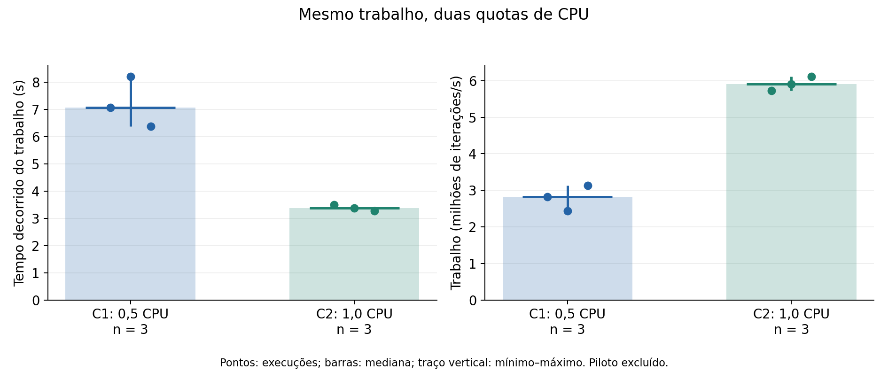

# Virtualização, namespaces e cgroups

## Sistemas Operacionais - Atividade 3 (2026.2)

Universidade Federal de Sergipe

Bruno Amancio Ferreira; Christian Will Silva Santos Nunes; Iasmin Victoria Teixeira Barreto; Marcos Vinícius Dantas Aguiar; Pedro César Figueiredo Carneiro; Sibele Oliveira Cruz; Silas Santos da Silva.

## Objetivo e recorte

Investigar como contêineres Linux apresentam visões distintas de processos, montagens e rede, e como cgroups limitam o consumo de recursos no kernel compartilhado. O laboratório utiliza scripts próprios, desenvolvidos com assistência do Codex, sem o kit de apoio do docente.

A Atividade 2 forneceu a experiência com Linux, coleta, dados sintéticos, reprodutibilidade e análise. Seu pipeline usava espera simulada e não foi reutilizado como benchmark de quota. A carga desta atividade é um cálculo aritmético de trabalho fixo, uma thread e memória constante, sem LLM ou GPU.

## Resultado observado

Os dois contêineres apresentaram handles diferentes para PID, mount e network. Ambos tinham um processo Python com PID 1 interno e PIDs distintos no host do daemon. A leitura do documento sintético foi permitida e a escrita na montagem somente leitura retornou EROFS.

As seis execuções principais concluíram 20.000.000 de iterações com o mesmo checksum. A mediana do tempo decorrido foi 7,0739 s em 0,5 CPU e 3,3840 s em 1 CPU, razão observada de 2,090 vezes. Os limites foram conferidos nos arquivos do cgroup. As condições de 0,5 CPU registraram throttling durante o trabalho.

## Identificação e situação

Coleta principal: 07/11/2026, aproximadamente 22h39-22h40, America/Sao_Paulo. Os registros usam UTC: 08/11/2026, 01h39-01h40.

Lote: `20261108T013949Z-19921f7f`. Repositório: https://github.com/4rwill/SO_UFS_2026_2_Bruno_Amancio_Christian_Will.

Este documento está preparado para revisão da equipe. Contribuições individuais efetivas, URL do vídeo e commit final da entrega permanecem pendentes. A entrega está prevista para 10/11/2026, com apresentação em 11/11/2026.

<!-- pagebreak -->

## 1. Ambiente e camadas de virtualização

| Camada | Evidência observada |
|---|---|
| Hardware | Intel Core i5-11260H, 6 núcleos, 12 CPUs lógicas; RAM física reportada: 8.358.518.784 bytes |
| Host | Windows 10 Home Single Language, versão 10.0.19045, build 19045 |
| Ambiente Linux do daemon | Docker Desktop sobre infraestrutura WSL2, kernel 6.18.54.1-microsoft-standard-WSL2 |
| Recursos anunciados pelo daemon | 12 CPUs lógicas; 3.989.606.400 bytes de RAM, aproximadamente 3,72 GiB |
| Runtime | Docker Desktop 4.96.3; Engine 29.9.2; Compose v5.6.1 |
| Cgroups | v2, driver cgroupfs; controladores cpu, memory e pids observáveis nos contêineres |
| Imagem de usuário | Imagem oficial Python 3.12 slim, Debian GNU/Linux 13 (trixie), arquitetura amd64 |

Os contêineres compartilham o kernel Linux da infraestrutura WSL2. Cada imagem fornece bibliotecas e espaço de usuário. O Windows é o host físico e existe uma camada de virtualização Linux intermediária. Uma VM envolve um kernel convidado e virtualização de hardware mediada pelo hypervisor; o contêiner é um conjunto de processos sob o kernel compartilhado [1, 2]. Não foi instalada VM adicional.

A distribuição Ubuntu acessível no WSL foi usada na análise e nos testes. Ela não deve ser confundida com a distribuição do daemon, que se identifica como Docker Desktop, ou com Debian da imagem. `uname` observa o kernel compartilhado; `/etc/os-release` dentro da imagem descreve seu espaço de usuário.

Imagem fixada para todas as observações:

`python@sha256:4840d514c583a4d3d8cad3940e68dee6f0f6f3635c12fcd0a3d74c21a5b93a54`

Fontes locais: `docker-environment.json`, `linux-environment.json` no lote principal e inventário complementar `results/evidence/host-20261108T014504Z/environment.json`.

<!-- pagebreak -->

## 2. Namespaces e montagem somente leitura

Dois contêineres independentes da mesma imagem permaneceram ativos durante a coleta. O processo inicial de ambos era Python. Os registros completos contêm o status de `/proc/1`, os handles e campos selecionados de inspect.

| Recurso | Contêiner A | Contêiner B | Interpretação |
|---|---|---|---|
| PID no host do daemon | 567 | 612 | Processos distintos na visão informada pelo Docker |
| PID interno | 1 | 1 | Numeração relativa ao namespace de cada contêiner |
| PID namespace | pid:[4026532292] | pid:[4026532483] | Handles distintos |
| Mount namespace | mnt:[4026532287] | mnt:[4026532480] | Handles distintos |
| Network namespace | net:[4026532405] | net:[4026532485] | Handles distintos |

Os nomes usados foram `so-atv3-8b23fdc285-ns-a` e `so-atv3-8b23fdc285-ns-b`. Os handles são observações desta execução e podem mudar em uma reprodução. Diferentes handles sustentam a existência de namespaces distintos [1]. Eles não demonstram isolamento absoluto nem independência de kernel. A rede foi desativada com `--network none`; não houve teste de tráfego.

O PID de inspect pertence ao host do daemon. Na coleta complementar, tentar ler esse PID pelo `/proc` acessível via `wsl -d docker-desktop` retornou arquivo inexistente. Essa visão não permite localizar os ancestrais reais do contêiner. A limitação foi preservada, sem inferir que outro `/proc` seja equivalente.

## 2.1 Restrição de escrita

O diretório sintético foi montado em `/dados` como somente leitura. A aplicação leu `texto.txt` e tentou criar exclusivamente `/dados/tentativa-escrita.txt`.

| Verificação | Observação |
|---|---|
| Leitura | Documento sintético recuperado integralmente |
| Escrita | Negada, errno 30, Read-only file system (EROFS) |
| Mount observado | Opção ro no ponto de montagem /dados |
| Identidade | UID 65534, sem root |
| Capabilities efetivas | CapEff = 0000000000000000 |
| Novos privilégios | NoNewPrivs = 1 |
| Seccomp | Modo 2 observado |

Mount namespace define a visão das montagens; a opção ro restringe escrita naquele mount; UID e permissões determinam identidade/acesso; capabilities e no-new-privileges reduzem privilégios. Esses mecanismos têm papéis diferentes [1, 3]. O erro EROFS e a opção ro sustentam especificamente a restrição da montagem, além da negação de escrita.

<!-- pagebreak -->

## 3. Método e limites efetivos

Um piloto separado de 1.000.000 de iterações levou 0,3095 s sob 0,5 CPU. A calibração escolheu e congelou N=20.000.000 antes das seis execuções, respeitando o teto de 20.000.000 adotado pelo roteiro. O piloto está preservado e não entra nas estatísticas principais.

Cada iteração acumula `i*i + 3*i + 7`, módulo 2^32. A soma esperada é calculada independentemente por fórmula fechada: soma dos quadrados, três vezes a soma dos inteiros e 7*N, módulo 2^32. Para N=20.000.000, o checksum é 2589261568. As seis execuções concluíram todo o trabalho e concordaram com esse oráculo.

| Condição | cpu.max observado | memory.max | memory.swap.max | pids.max |
|---|---|---:|---:|---:|
| C1, 0,5 CPU | 50000 100000 | 268435456 | 0 | 64 |
| C2, 1 CPU | 100000 100000 | 268435456 | 0 | 64 |

Os valores de cpu.max representam tempo agregado de CPU por período, em microssegundos. C1 pode consumir 50 ms por período de 100 ms. A quota não fixa afinidade nem reserva um núcleo [2, 3]. A imagem, o trabalho e os demais limites foram mantidos. A combinação Docker memory=256m e memory-swap=256m corresponde a 256 MiB totais e swap adicional zero, confirmado por memory.swap.max [3]. O limite pids controla tarefas, incluindo threads, e foi confirmado sem provocar esgotamento.

Foram usados contêineres novos na ordem C1/C2, C1/C2, C1/C2. O tempo decorrido mede apenas o laço, excluindo criação do contêiner, inicialização do Python e coleta posterior. Tempo de CPU usa process_time. Os deltas de cpu.stat abrangem os snapshots imediatamente antes/depois do laço e pequena sobrecarga de leitura.

| Execução | Wall (s) | CPU do processo (s) | Iterações/s |
|---|---:|---:|---:|
| C1-1 | 7,0739 | 3,5227 | 2827285 |
| C2-1 | 3,4952 | 3,4947 | 5722124 |
| C1-2 | 8,2050 | 4,1136 | 2437526 |
| C2-2 | 3,3840 | 3,3829 | 5910140 |
| C1-3 | 6,3852 | 3,1909 | 3132258 |
| C2-3 | 3,2737 | 3,2732 | 6109225 |

Todas retornaram status completed, exit code zero e correção verdadeira. Há watchdog interno de 60 s e externo de 90 s. Os seis registros, os comandos, os snapshots do código e 68 arquivos conferidos por SHA-256 estão preservados. A limpeza dos contêineres do lote foi confirmada.

<!-- pagebreak -->

## 4. Resultados e throttling

Figura 1. Pontos representam as três observações de cada condição; barras indicam mediana e traços verticais indicam mínimo-máximo. Fonte: dados brutos do lote principal, processados por summarize.py. O gráfico não inclui o piloto.

| Condição | n | Wall mediano (s) | Mínimo-máximo (s) | CPU mediana (s) | Mediana de milhões de iterações/s |
|---|---:|---:|---|---:|---:|
| C1 | 3 | 7,0739 | 6,3852-8,2050 | 3,5227 | 2,8273 |
| C2 | 3 | 3,3840 | 3,2737-3,4952 | 3,3829 | 5,9101 |

A razão entre medianas de wall, C1/C2, foi 2,090. A queda da mediana foi aproximadamente 52,2%. Trata-se de uma observação neste ambiente, com somente três repetições. Não se conclui um ganho universal ou exatamente igual a dois.

| Execução | Delta usage (s) | Delta nr_throttled | Delta throttled (s) |
|---|---:|---:|---:|
| C1-1 | 3,5247 | 71 | 3,5448 |
| C2-1 | 3,4978 | 0 | 0 |
| C1-2 | 4,1167 | 82 | 4,0880 |
| C2-2 | 3,3845 | 0 | 0 |
| C1-3 | 3,1923 | 64 | 3,1918 |
| C2-3 | 3,2748 | 0 | 0 |

Os deltas positivos de nr_throttled e throttled_usec em C1 sustentam a ocorrência de restrição de CPU durante o trabalho [2]. Em C1, CPU/wall ficou próximo de 0,5; em C2, próximo de 1. A convergência entre limites, contadores e tempos sustenta a interpretação, sem atribuir toda variação à quota.

A dispersão de C1 foi maior que a de C2. Ruído do host, escalonamento e variações de frequência/temperatura são causas possíveis, sem medição que as isole. A alteração de tempo de CPU entre repetições também recomenda cautela. Não há medição de tokens/s ou desempenho de inferência.

<!-- pagebreak -->

## 5. Memória, segurança e ameaças à validade

| Execução | RSS máximo do processo (MiB) | memory.current final (MiB) | memory.peak do grupo (MiB) |
|---|---:|---:|---:|
| C1-1 | 16,70 | 10,89 | 11,71 |
| C2-1 | 16,74 | 11,97 | 11,97 |
| C1-2 | 16,77 | 10,89 | 10,89 |
| C2-2 | 16,66 | 11,93 | 11,93 |
| C1-3 | 16,61 | 10,89 | 11,95 |
| C2-3 | 16,78 | 11,92 | 11,92 |

RSS máximo vem de getrusage do processo. memory.current representa o uso contabilizado no grupo em dois instantes; a tabela mostra o final. memory.peak cobre a vida do cgroup, inclusive inicialização. Compartilhamento e contabilização diferem, portanto não se exige igualdade entre RSS e memória do grupo. Nenhum desses campos é denominado RAM média [2]. Os valores exatos em bytes e as amostras iniciais estão em runs.csv.

O teto efetivo de 256 MiB e pids.max=64 foram confirmados, sem OOM deliberado ou criação excessiva de tarefas. O experimento demonstra configuração e observação dos limites, sem provar todos os comportamentos ao atingi-los. RAM do cgroup não é uma quota de VRAM.

## 5.1 Relação com servidores de inferência

Em um servidor que compartilha recursos, limites de CPU reduzem a capacidade de uma carga monopolizar tempo de processamento. Teto de memória e limite de tarefas reduzem o impacto de alocações e criação excessiva de processos/threads. Um corpus montado read-only reduz alterações acidentais ou indevidas nos documentos. Usuário não root, remoção de capabilities e no-new-privileges restringem ações disponíveis.

Permanecem riscos associados ao kernel e runtime compartilhados, ao host, às permissões concedidas e aos dados expostos. A negação de escrita em /dados não prova isolamento absoluto, e os limites locais não garantem disponibilidade externa. Atualização de kernel/runtime e configuração adequada continuam necessárias [1, 2, 3]. Não foram montados home, raiz do host, Docker socket ou diretórios sigilosos.

## 5.2 Limitações experimentais

A principal ameaça à validade é a ausência de exclusividade e controle do host: há apenas três repetições, alternância fixa e nenhuma medição contínua de carga externa, frequência ou temperatura. A calibração pequena pode sofrer efeitos de período da quota e inicialização, embora o trabalho principal permaneça fixo e termine com margem para os watchdogs.

Os cgroup namespaces ocultam ancestrais. A tentativa complementar de mapear o PID do daemon no /proc acessível via WSL falhou e foi preservada. Limites ancestrais externos não foram confirmados; a RAM e CPUs anunciadas pelo daemon são restrições do ambiente intermediário. A limitação impede afirmar ausência de interferência superior, sem invalidar as leituras locais de cpu.max, memory.max e pids.max.

O teste usa aritmética Python e memória constante. Não avalia LLM, GPU, rede, armazenamento sob carga, isolamento entre tenants nem esgotamento de RAM/tarefas. As conclusões ficam restritas a este laboratório.

<!-- pagebreak -->

## 6. Reprodutibilidade e validação

O código está em atividade3/scripts. lab.py cria snapshots do código e do documento sintético em cada lote e monta apenas essas cópias read-only. Os contêineres não acessam rede. Um identificador novo preserva resultados anteriores. A coleta registra todos os comandos, saídas, erros e limites observados.

O manifesto registra o commit base `9f8ad355769af28f7252a5700905476b6dc6a413`, com a atividade3 ainda não commitada, além dos hashes dos scripts executados. Esse commit base não deve ser descrito como commit da nova entrega. Os snapshots preservam o código exato usado nas medições. O commit final será registrado após a revisão da equipe.

Auditoria: executar, da raiz do repositório, `python atividade3/scripts/audit.py atividade3/results/raw/20261108T013949Z-19921f7f`.

A auditoria verificou 68 arquivos, imagem fixa, seis execuções, checksums recalculados, sequência alternada pelos horários do daemon, limites efetivos antes/depois, deltas dos contadores, controles de privilégio e limpeza. O inventário SHA-256 evidencia integridade interna, sem equivaler a assinatura ou atestado independente da origem das medições.

Seis testes passaram no Ubuntu WSL. Eles verificam o oráculo aritmético, rejeição de limites ausentes/incorretos, leitura do lote real, detecção de arquivo alterado e rejeição de checksum ou quota do kernel alterados mesmo com inventário de hashes recalculado. As alterações dos testes ocorrem exclusivamente em fixtures temporárias.

Duas tentativas anteriores no terminal restrito Windows falharam por permissões em diretórios temporários do Python. Os logs foram preservados e a verificação foi executada no ambiente Linux. Não houve falha nas seis cargas Docker. O gráfico foi gerado no ambiente Matplotlib 3.10.8 já utilizado na Atividade 2, sem instalação adicional nesta sessão.

## 6.1 Uso crítico de IA

Ferramenta: Codex. O identificador exato do modelo desta sessão não estava disponível por fonte verificável e deve ser confirmado pela equipe quando possível. A assistência incluiu implementação, coleta autorizada, auditoria, documentação, cálculos e materiais de apresentação. Não houve adaptação do kit do docente.

Prompts relevantes: (1) analisar a viabilidade da Atividade 3 com base na Atividade 2; (2) começar a implementação sem o kit de apoio. O primeiro prompt orientou a análise e o segundo autorizou a execução.

Sugestão adotada: substituir a espera simulada por carga determinística com fórmula independente. Verificação: checksum comum nas seis cargas e testes do oráculo. Sugestão corrigida durante o desenvolvimento: não tratar o /proc acessível via WSL como equivalente ao host do daemon, após a leitura do PID falhar. Verificação: logs do probe complementar e interpretação conforme o enunciado. Sugestão rejeitada: reutilizar diretamente os tempos do pipeline com sleep para medir quota de CPU. A justificativa está no código e na metodologia de trabalho fixo.

O uso de IA não substitui revisão, compreensão e responsabilidade acadêmica da equipe.

<!-- pagebreak -->

## 7. Participação e preparação da entrega

Os nomes abaixo são os da equipe da Atividade 2. A divisão é uma proposta de revisão/apresentação e ainda precisa ser confirmada. Não é registro de contribuição já realizada na Atividade 3.

| Integrante | Proposta de revisão e participação |
|---|---|
| Bruno Amancio Ferreira | Objetivo, organização e conferência da entrega |
| Christian Will Silva Santos Nunes | Código da carga, reprodução e demonstração |
| Iasmin Victoria Teixeira Barreto | Ambiente, camadas e metodologia |
| Marcos Vinícius Dantas Aguiar | Cgroups, quotas e interpretação do throttling |
| Pedro César Figueiredo Carneiro | Namespaces, PID interno e host do daemon |
| Sibele Oliveira Cruz | CSV, gráfico, mediana e variação |
| Silas Santos da Silva | Mount read-only, riscos, limitações e revisão |

O roteiro de 10-12 minutos está em docs/apresentacao.md, com um momento de demonstração selecionada e tempo para todos. O vídeo deve identificar a participação de todos e não substitui a apresentação presencial.

URL do vídeo: pendente de gravação e publicação. A URL deve constar neste relatório, no README e em VIDEO.md. No Classroom, fornecer somente o link conforme o enunciado.

Pendências humanas: confirmar contribuições efetivas e nomes, revisar conteúdo e assistência de IA, gravar/hospedar o vídeo, inserir a URL, ensaiar a exposição, registrar o commit final e efetuar a submissão até 10/11/2026. Não há comprovação de submissão nesta versão.

## Referências

[1] Linux man-pages. namespaces(7). https://man7.org/linux/man-pages/man7/namespaces.7.html. Consulta em 07/11/2026.

[2] Linux Kernel Documentation. Control Group v2. https://docs.kernel.org/admin-guide/cgroup-v2.html. Consulta em 07/11/2026.

[3] Docker Documentation. Resource constraints; Running containers. https://docs.docker.com/engine/containers/resource_constraints/ e https://docs.docker.com/engine/containers/run/. Consulta em 07/11/2026.

[4] Universidade Federal de Sergipe. Sistemas Operacionais - Atividade 3: Virtualização, contêineres, namespaces e cgroups. Enunciado revisado, disponibilizado pela equipe, versão de 05/11/2026, entrega em 10/11/2026.

[5] Equipe GenResearch. Relatório e repositório da Atividade 2. Usados como referência de organização e experiência anterior; os resultados desta atividade provêm exclusivamente do novo lote.
