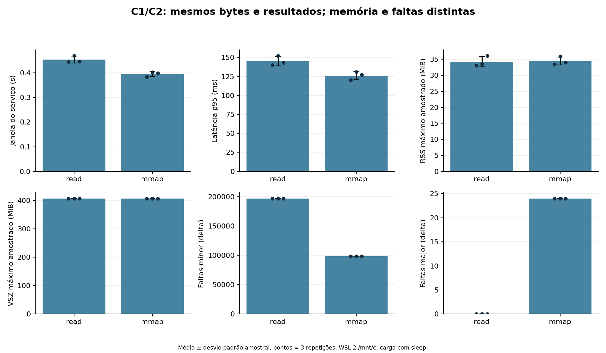
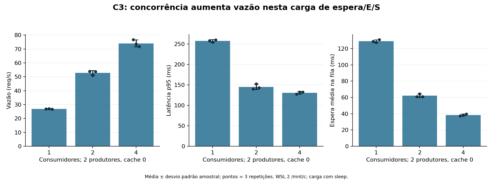
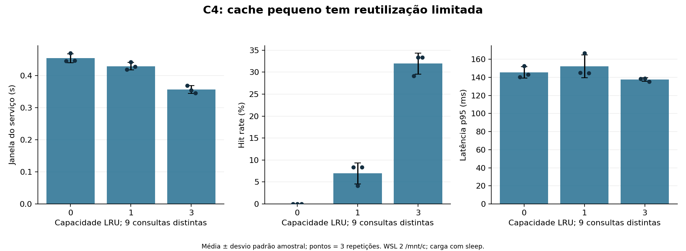
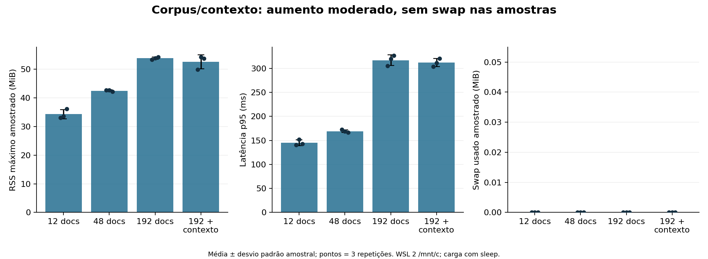
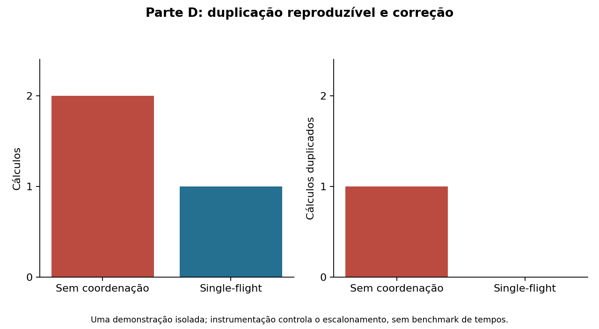

# Análise dos resultados reais — 10/10/2026

Fonte principal: lote 15c7fb31a435409597342b40f0d70665, 11 configurações × 3
repetições, 24 consultas por repetição, Ubuntu/WSL 2, arquivos em /mnt/c.
Tabelas e cinco gráficos PNG/SVG foram gerados por experiments/plot_results.py
em results/analysis/matrix-15c7fb31, sem edição dos números ou dados brutos.
table.md contém média ± desvio padrão amostral; runs.csv conserva valores por
repetição; diagnostics.csv contém tempos de etapas dos cálculos efetivamente
realizados. provenance.json registra hashes de entrada e versões de análise.

O serviço recupera vetores lexicais simulados e gera resposta com sleep de 0,01 s.
Os ganhos abaixo descrevem esta carga pequena com espera/E/S e logging; não
medem inferência de um modelo nem provam desempenho de uma aplicação comercial.
Não foram realizados testes de significância. Três repetições não são intervalo
de confiança; barras mostram desvio padrão amostral e pontos mostram os três
runs. p95 é nearest-rank entre consultas de cada run (24 quando bem-sucedido).

## C1/C2 — leitura convencional e mmap



A janela do serviço foi 0,454 ± 0,014 s em read e 0,395 ± 0,010 s em mmap;
vazão 52,90 ± 1,59 versus 60,72 ± 1,57 req/s. O p95 foi 145,31 ± 6,31 ms
versus 126,23 ± 5,38 ms. Isso é uma redução observada de aproximadamente 12,9%
da janela média. Não constitui superioridade geral: só foi comparado este corpus
pequeno, neste filesystem e nesta ordem de condições, com aquecimento.

Separando etapas (média das médias por consulta de cada run), abertura/mapeamento
foi cerca de 0,92 ms em read e 1,32 ms em mmap; acesso/cópia/fechamento foi
7,24 ms e 1,03 ms. Carregamento, que inclui metadados/checksums/JSON, foi
15,10 ms e 9,01 ms. Abertura mais cara em mmap não impediu menor tempo total
observado. O mmap copia integralmente os mesmos bytes, portanto não é zero-copy.

RSS máximo amostrado médio ficou semelhante: 34,29 ± 1,63 e 34,49 ± 1,25 MiB.
VSZ máximo amostrado ficou cerca de 407,67 MiB nos dois. RSS indica páginas
residentes; VSZ inclui espaço virtual reservado/mapeado, sem equivaler a RAM
consumida. Os campos usados são os de /proc, cuja documentação distingue essas
medidas e contagens de faltas. [Linux /proc](https://www.kernel.org/doc/html/latest/filesystems/proc.html).

Delta minor foi aproximadamente 196918 em read e 98697 em mmap; major foi 0
em read e 24 em cada run mmap. É um resultado inesperado que precisa permanecer
na análise. Não pode ser traduzido em bytes físicos, swap ou disco frio: os
contadores de E/S por processo estão indisponíveis e há integração WSL/DrvFS.
Não foi isolada a causa dessas contagens; em particular, elas não comprovam
que ocorreram 24 leituras físicas equivalentes nem thrashing.

As janelas das repetições 1/2/3 de read foram cerca de 0,445/0,470/0,447 s;
em mmap, 0,384/0,403/0,399 s. A segunda não foi automaticamente mais rápida.
Cada processo fez aquecimento antes da medição; nenhuma dessas é disco frio
verificado. A comparação de mmap para corpus maior ainda não foi executada.

## C3 — trabalhadores, fila e contenção



Com 1/2/4 consumidores, vazão média foi 26,93/52,90/74,03 req/s; p95 foi
257,46/145,31/130,82 ms; espera média na fila foi 129,05/62,17/38,39 ms.
Todos usaram 2 produtores, fila 4 e cache desativado. A condição de 2 consumidores
reutiliza C1-read. As threads sobrepõem espera e E/S; a documentação Python
explica sua adequação a esse tipo de carga e as restrições do GIL para bytecode
CPU-bound. [Python threading](https://docs.python.org/3.14/library/threading.html).

O ganho de 1 para 2 foi cerca de 1,96×; de 2 para 4, cerca de 1,40×. Há retorno
decrescente, mas não houve queda de vazão até 4 nem foi encontrado ponto de
saturação. Logging serializado, GIL, cópia/parse e integração de arquivos são
possíveis custos; sua contribuição individual não foi medida. Utilização aqui
é tempo ocupado/janela, inclui espera e não é porcentagem de CPU: aproximadamente
92% por trabalhador com 2 e 82–89% com 4 nos runs observados.

RSS máximo amostrado médio subiu de 31,93 MiB (1) para 34,29 MiB (2) e
50,33 MiB (4). O VSZ com 4 chegou a aproximadamente 504,67 MiB, próximo ao
limite de espaço virtual de 512 MiB, apesar do RSS muito menor. Não confundir
reserva virtual com pressão física. O limite pode influenciar alocação e reduz
generalização; não houve erro de memória observado nestas execuções.

## C4 — reutilização, misses e economia observada



Cache 0/1/3 teve hit rate médio de 0/6,94/31,94%, e janela média de
0,454/0,429/0,356 s. Comparando condições de mesmo corpus/textos/ordem, a
redução das janelas médias com capacidade 3 foi aproximadamente 21,5%; com
capacidade 1, cerca de 5,4%. São comparações pareadas por plano/repetição,
executadas em momentos diferentes, não economia isolada de cada hit.

A capacidade 1 teve 19/21/20 substituições e só 2/1/2 hits; capacidade 3 teve
12/11/11 substituições e 7/8/8 hits. Existem 9 consultas distintas, incluindo
6 sufixos específicos; mesmo cache 3 não conserva todo o conjunto. Ordem de
conclusão concorrente afeta LRU e explica por que contagens variam entre runs,
apesar da ordem de submissão predefinida.

O p95 com capacidade 1 foi 152,23 ± 12,63 ms, maior e mais variável que sem
cache (145,31 ± 6,31 ms). Capacidade 3 teve 137,51 ± 1,95 ms. Logo diminuir a
janela não garante melhoria da cauda de latência. Não concluir causalidade
precisa dessa diferença com três runs. Seguidores single-flight contam como
miss/coalesced, não hits: foram 1–2 por run com capacidade 1 e 2 com capacidade
3. Miss rate é 1 − hit rate, separado de erro de execução.

O tempo originalmente calculado contido em result de um hit não é sua duração
atual; processing_s/latency_s registram a requisição real. A estimativa bruta
cache_avoided_s_estimate não desconta espera/logging e não deve ser apresentada
como economia líquida. A comparação entre condições acima é evidência mais
adequada para a duração da carga, com as limitações de ordem/ambiente declaradas.

## Corpus, contexto, lote e pressão de memória



Corpus pequeno/médio/maior: 20797/83270/333022 bytes, índices de
75314/302273/1206322 bytes e 96/384/1536 fragmentos. RSS máximo amostrado
médio foi 34,29/42,48/53,83 MiB; p95 145,31/169,30/317,18 ms; vazão
52,90/45,44/25,25 req/s. Aumento de corpus/índice acompanha maior memória e
latência. Corpus e índice variam juntos: não se pode atribuir separadamente
o custo ao texto versus vetor/JSON. Lote de consultas ficou fixo em 24 e não
foi variado; seus efeitos são uma questão conceitual, não resultado medido.

C5 manteve corpus maior e ampliou top-k/contexto de 3/512 para 32/8192.
RSS médio máximo amostrado foi 52,59 ± 2,41 MiB, comparado a 53,83 ± 0,41;
p95 311,95 ± 8,36 ms versus 317,18 ± 11,11. Não há aumento claro nessas
medidas. O corpus já é carregado integralmente e a geração sleep não aumenta
com tokens; essas escolhas limitam sensibilidade ao contexto. São explicações
plausíveis da implementação, sem mecanismo isolado experimentalmente.

Swap usado foi 0 em todas as amostras; major foi 0 nas condições read. Não
houve evidência suficiente de thrashing ou pressão intensa. C5 deve ser
apresentado como escala moderada limitada, não como demonstração de OOM ou
degradação por swap. Não extrapolar para corpus ou modelos que não cabem em RAM.

## Sincronização e falhas



Recursos compartilhados: fila, LRU/pending, log e índice em arquivos imutáveis.
Queue coordena espaço/dados; lock do cache protege decisão e estado; Event por
chave permite espera; lock do log serializa linhas. Não manter lock global
durante cálculo evita bloquear chaves independentes, ao custo de coordenação,
espera de seguidores e propagação de falha do owner.

A demonstração isolada forçou dois misses antes do cálculo: versão sem proteção
executou duas vezes, enquanto single-flight executou uma vez, com resultados
iguais e encerramento confirmado. A falha foi duplicação de trabalho, sem
alegar corrupção textual. Não foi demonstrado deadlock/starvation. Tempo do
seguidor inclui instrumentação; a comparação válida é contagem de cálculos.

C6 índice ausente registrou 72 falhas controladas (24 × 3), sem perder IDs;
configuração seguinte com índice disponível concluiu 72 consultas, p95 médio
147,37 ms, próximo da linha base. Essa recuperação é entre processos, não
retentativa automática. No lote, 720 consultas concluíram, 72 falharam
intencionalmente, sem perdas, duplicações ou threads restantes. Saturação e
restauração de arquivo foram verificadas funcionalmente na etapa 3; não foram
misturadas nos números desta matriz.

## Relação com RAG e limites de generalização

Documentos, índice e vetores concorrem por RAM e armazenamento; contexto e
resultados ocupam buffers/cache; filas transformam capacidade insuficiente em
espera ou recusa. O cache da aplicação evita repetir recuperação/geração; o
cache de páginas do SO pode evitar acesso ao armazenamento, mas são mecanismos
distintos. mmap permite mapeamento sob demanda, embora esta implementação copie
e parseie tudo; ela não demonstra benefício de acesso esparso/zero-copy.

Embeddings reais, checkpoints e pesos maiores podem exceder memória disponível,
mas não foram carregados. Checkpoints, GPU/VRAM, múltiplas GPUs e sistemas
distribuídos são relações conceituais, não resultados: incluem novos custos de
transferência, alocação, particionamento, rede e sincronização. O projeto não
permite quantificá-los. GPU disponível permaneceu sem uso.

Limites principais: dados pequenos sintéticos, vetores com colisões por hashing,
geração de custo fixo por sleep, JSON/cópias, logs síncronos, 3 repetições e 24
consultas/run, condições em ordem fixa sem randomização, amostragem que pode
perder picos, WSL/DrvFS, limite de VSZ, E/S/syscalls por processo indisponíveis.
Campos null não significam zero. Faltas major de mmap precisam de investigação
para explicar causalmente. Evidências complementares de processos/syscalls
estão em docs/evidence.md; a coleta não isolou a causa dessas faltas.

## Reprodução da análise

Comando executado na raiz do projeto Linux:

```bash
PYTHONPATH=src:. /home/will/.venvs/genresearch/bin/python experiments/plot_results.py --input results/raw/matrix/15c7fb31a435409597342b40f0d70665 --race results/raw/stage4/7309c1af68234c8aa1f17d02d92f4737 --output results/analysis/matrix-15c7fb31
```

Saída exige destino novo. Matplotlib 3.10.8 e dependências testadas estão em
requirements-analysis-lock.txt; aplicação de medição usou biblioteca padrão.
Cinco PNG foram inspecionados visualmente: eixos/unidades, dispersão, legendas
e textos legíveis. Gráficos SVG estão disponíveis para slides/relatório.
O fonte do relatório técnico está em deliverables/relatorio.tex; os dados
originais e a proveniência permanecem preservados.
